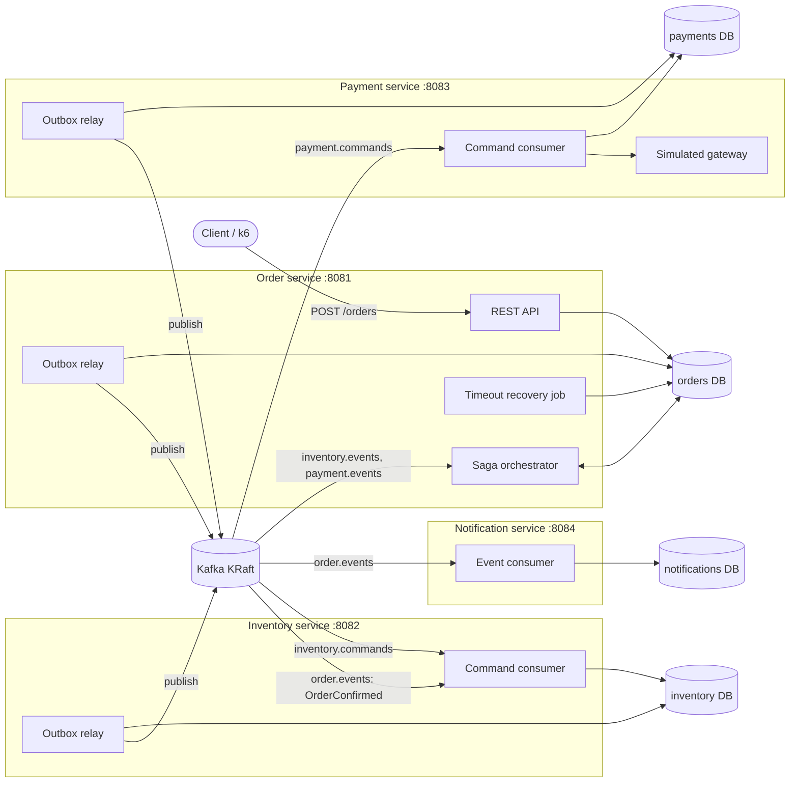
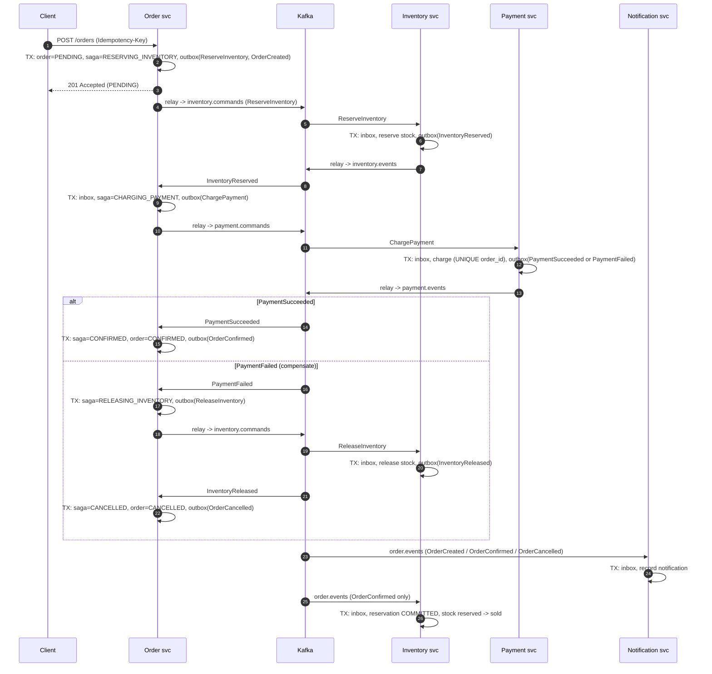
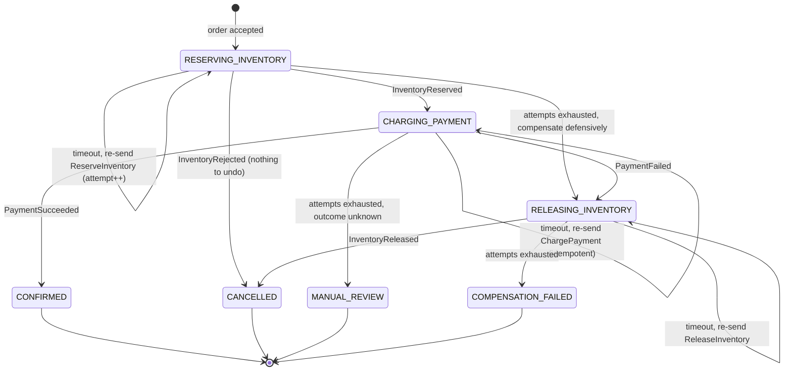

# 02 - Architecture

Design for the Event-Driven Order Processing Platform. Decisions referenced as ADR-000N. Parts that are deliberately over-built for learning are marked **[learning]**.

## 1. Component view



Rules: services never call each other over HTTP; each service has its own database (one Postgres instance with four databases locally, **[learning]** four separate instances would be more faithful); every arrow into Kafka goes through an outbox relay.

## 2. Happy path and payment-failure sequence



Message count: happy path 6 (OrderCreated, ReserveInventory, InventoryReserved, ChargePayment, PaymentSucceeded, OrderConfirmed). Failure path 8 (adds PaymentFailed, ReleaseInventory, InventoryReleased, OrderCancelled; minus PaymentSucceeded/OrderConfirmed). The capacity budget uses 8.

## 3. Saga state machine (Order service)



Rules:
- Transitions are applied with an optimistic `version` check. An event that does not fit the current state (stale, duplicate, reordered) is **recorded and ignored**, never applied (F10).
- **Pivot:** `CHARGING_PAYMENT` never moves to a compensating state on timeout. The charge is idempotent (keyed by `order_id`), so re-sending is safe; cancelling an order that may already be charged is not (F13).
- `MANUAL_REVIEW` and `COMPENSATION_FAILED` are terminal-for-the-machine states that raise an alert and are listed on an admin endpoint. They are the honest answer to "what if compensation fails": bounded retry, then make the failure loud and visible, never silent.
- Each non-terminal state has `deadline_at`; the recovery job claims overdue rows with `FOR UPDATE SKIP LOCKED`, so multiple Order instances are safe.

## 4. Topics

| Topic | Producer | Consumer | Message types |
|---|---|---|---|
| `inventory.commands` | Order | Inventory | `ReserveInventory`, `ReleaseInventory` |
| `inventory.events` | Inventory | Order | `InventoryReserved`, `InventoryRejected`, `InventoryReleased` |
| `payment.commands` | Order | Payment | `ChargePayment` |
| `payment.events` | Payment | Order | `PaymentSucceeded`, `PaymentFailed` |
| `order.events` | Order | Notification (all types); Inventory (`OrderConfirmed` only, commits the reservation) | `OrderCreated`, `OrderConfirmed`, `OrderCancelled` |

- Key = `orderId`; 6 partitions each; RF 1 locally.
- Retry topics (non-blocking, Spring Kafka `@RetryableTopic`): `<topic>-retry-<n>`; dead letters: `<topic>-dlt`. Final names are set in Phase 5.
- Consumer groups: one per service per topic, named `<service>-<topic>`.

## 5. Event envelope

JSON, produced by `common`'s `EventEnvelope`:

```json
{
  "eventId": "uuid, dedup key, assigned when the outbox row is created",
  "type": "InventoryReserved",
  "schemaVersion": 1,
  "aggregateId": "orderId",
  "occurredAt": "2026-11-04T18:00:00Z",
  "payload": { }
}
```

Kafka headers: `traceparent` (W3C trace context), `eventId`, `type`. Payloads are additive-only within a `schemaVersion`; breaking changes bump the version and consumers must handle both during rollout. Money: integer `amountCents` + `currency`.

## 6. Data model (per service, Flyway migrations)

Shared shape in every service:

```sql
CREATE TABLE outbox (
  id            BIGSERIAL PRIMARY KEY,
  event_id      UUID NOT NULL UNIQUE,
  topic         TEXT NOT NULL,
  msg_key       TEXT NOT NULL,
  type          TEXT NOT NULL,
  payload       JSONB NOT NULL,
  headers       JSONB NOT NULL DEFAULT '{}',
  created_at    TIMESTAMPTZ NOT NULL DEFAULT now(),
  published_at  TIMESTAMPTZ
);
CREATE INDEX outbox_unpublished ON outbox (id) WHERE published_at IS NULL;

CREATE TABLE inbox (
  consumer      TEXT NOT NULL,
  event_id      UUID NOT NULL,
  processed_at  TIMESTAMPTZ NOT NULL DEFAULT now(),
  PRIMARY KEY (consumer, event_id)
);
```

Order service:

```sql
CREATE TABLE orders (
  id UUID PRIMARY KEY, customer_id TEXT NOT NULL,
  amount_cents BIGINT NOT NULL CHECK (amount_cents > 0), currency CHAR(3) NOT NULL,
  status TEXT NOT NULL, idempotency_key TEXT UNIQUE,
  created_at TIMESTAMPTZ NOT NULL DEFAULT now(), updated_at TIMESTAMPTZ NOT NULL DEFAULT now());
CREATE TABLE order_items (
  order_id UUID REFERENCES orders(id), sku TEXT NOT NULL, quantity INT NOT NULL CHECK (quantity > 0),
  PRIMARY KEY (order_id, sku));
CREATE TABLE saga_instances (
  order_id UUID PRIMARY KEY REFERENCES orders(id), state TEXT NOT NULL,
  attempts INT NOT NULL DEFAULT 0, deadline_at TIMESTAMPTZ, version BIGINT NOT NULL DEFAULT 0,
  last_error TEXT, updated_at TIMESTAMPTZ NOT NULL DEFAULT now());
CREATE INDEX saga_overdue ON saga_instances (deadline_at) WHERE state IN
  ('RESERVING_INVENTORY','CHARGING_PAYMENT','RELEASING_INVENTORY');
```

Inventory service:

```sql
CREATE TABLE stock (
  sku TEXT PRIMARY KEY,
  available INT NOT NULL CHECK (available >= 0),
  reserved  INT NOT NULL CHECK (reserved  >= 0),
  sold      INT NOT NULL DEFAULT 0 CHECK (sold >= 0));
CREATE TABLE reservations (
  order_id UUID PRIMARY KEY, status TEXT NOT NULL,  -- RESERVED | RELEASED | COMMITTED
  items JSONB NOT NULL, created_at TIMESTAMPTZ NOT NULL DEFAULT now());
```

Reserve = insert reservation (PK makes it idempotent) then `UPDATE stock SET available = available - :q, reserved = reserved + :q WHERE sku = :sku AND available >= :q`; zero rows updated -> rollback and emit `InventoryRejected`. Items are processed in sorted SKU order to avoid deadlocks.

Payment service: `payments(id UUID PK, order_id UUID UNIQUE NOT NULL, amount_cents, currency, status, failure_reason, created_at)`.
Notification service: `notifications(id UUID PK, order_id UUID, type TEXT, event_id UUID UNIQUE, created_at)`.

Note: a confirmed order must move stock `reserved -> sold` (reservation `COMMITTED`). Order publishes `OrderConfirmed`; Inventory consumes it on `order.events` as a commit step. This keeps invariant I3 (`initial = available + reserved + sold`) checkable. It is a fourth consumer relationship (Inventory also subscribes to `order.events`). Decision: include it in v1, since otherwise stock never leaves "reserved".

## 7. Exactly-once effect, end to end

1. Producer side: state change + outbox row in one local txn (ADR-0002). Idempotent producer, `acks=all`.
2. Delivery is at-least-once; duplicates are expected, not exceptional.
3. Consumer side: `inbox` insert + effect + outgoing `outbox` row in one txn; offset acked after commit (ADR-0003).
4. Unique constraints (`payments.order_id`, `reservations.order_id`) catch logic bugs.
5. Simulated gateway keyed by `order_id`, so even the external call is idempotent.

Crash windows: any crash before COMMIT -> nothing happened, redelivery retries. Any crash after COMMIT, before ack -> redelivery, inbox rejects, no second effect.

## 8. Sync vs async boundaries

- **Sync:** client -> Order REST only. `POST /orders` returns `201` as soon as the order and outbox rows commit; it does not wait for the saga.
- **Async:** everything else.
- `GET /orders/{id}` returns status and saga state. Clients poll.

## 9. API contracts (v1)

| Method | Path | Notes |
|---|---|---|
| POST | `/orders` | Header `Idempotency-Key` (optional but recommended). Body: `customerId`, `items[{sku, quantity}]`, `amountCents`, `currency`. `201` with `{orderId, status:"PENDING"}`. Same key again -> `200` with the original order. Validation errors -> `400`. |
| GET | `/orders/{id}` | `200` with `status`, `sagaState`; `404` if unknown. |
| PUT | `/stock/{sku}` (Inventory) | Seed or set stock for tests. |
| GET | `/admin/sagas?state=` (Order) | Lists `MANUAL_REVIEW` / `COMPENSATION_FAILED`. |
| POST | `/admin/dlt/replay` (or CLI) | Phase 5 replay tool. |
| GET | `/actuator/health`, `/actuator/prometheus` | Every service. |

Payment simulator knobs (config + test hooks): failure rate, latency, "fail for orderId", "succeed but drop the reply" (to exercise F13).

## 10. Observability plan

- **Tracing:** W3C `traceparent` in Kafka headers, written by the relay from the outbox row's stored headers and read by listeners, so one order is one trace across four services. Boot 4.1 release notes mention new Kafka observation conventions; whether they carry context automatically across our relay is to be confirmed in Phase 6, otherwise we propagate manually.
- **Metrics (Micrometer -> Prometheus):** `outbox_pending`, `outbox_oldest_age_seconds`, `outbox_published_total`, `inbox_duplicates_total`, `saga_transitions_total{from,to}`, `saga_duration_seconds`, `dlt_messages_total`, plus Kafka client consumer lag metrics. Group-level lag via a Kafka exporter is an option if client metrics are insufficient.
- **Logs:** structured JSON with `traceId`, `orderId`, `eventId`.
- **Dashboard (Grafana):** intake rate/latency, saga states, outbox age, consumer lag per group, DLT count, duplicates.
- **Alerts:** per `01-capacity-and-failure-modes.md` section 6.

## 11. Testing strategy

| Layer | Tooling | Examples |
|---|---|---|
| Unit | JUnit 5 | Saga transition table, envelope serde, reserve math |
| Integration | Testcontainers (Postgres, Kafka) | Outbox publishes; inbox dedups; reserve is atomic |
| Failure injection | Testcontainers + pausing/stopping containers | Broker down, consumer killed mid-txn, forced duplicates |
| Reconciliation | SQL invariants I1-I5 | Run after every injection test |
| Load | k6 | 200 orders/s, 5% payment failures |

## 12. Deliberately over-built for learning **[learning]**

- Four services and Kafka at a scale one Postgres could serve.
- Orchestrator + outbox + inbox + retry topics where a monolith needs a single DB transaction.
- Polling relay chosen over the lower-latency CDC option.

## 13. Known limitations (v1)

No auth, single broker, one Postgres instance, JSON without a registry, no backup/restore exercise, no multi-region.
